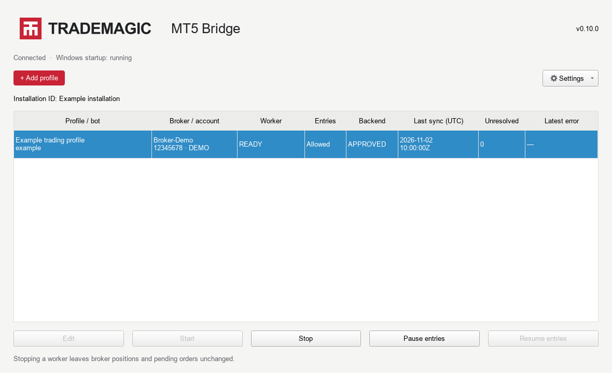

# TradeMagic MT5 Bridge

Official public downloads for the Windows MT5 Bridge.

**[Download the latest release](https://github.com/mjaliensys/tm_mt5_bridge/releases/latest)**

Supports explicitly configured **Demo and Live** MetaTrader 5 accounts. The backend supplies sizing, symbol mapping and execution instructions. Each enabled profile uses its own terminal/account, with verified identity, ownership fencing and durable command reconciliation.

## Install

Download the Windows x64 installer and `SHA256SUMS.txt` from the same release. Compare the installer SHA-256 before running it. See [setup](docs/SETUP.md) for profile, account environment, connection testing and startup configuration. The installer is **unsigned**.

## Update

Install the new release using **Reuse existing configuration**. Profiles stop and entries pause during maintenance; journals, identities and credentials are retained. Test the connection and explicitly restart/resume afterward. See [updates and recovery](docs/UPDATES.md).

Fixes are published as new versioned releases. Existing release assets are not silently replaced with different bytes. This repository distributes installers, checksums, release notes and update metadata; development is handled separately. It does not grant public write access: pushes require an authorized owner, collaborator or repository deploy key.

Version 0.12.1 reports journal access failures clearly and adds a targeted administrator repair with retained evidence and restart validation. See [release notes](releases/v0.12.1.md).

Version 0.12.0 improves command polling, exit ownership, history catch-up and post-trade reporting. Unknown clock gaps remain explicit. See [release notes](releases/v0.12.0.md).

Version 0.11.1 corrects fill-volume and protection verification for MT5 floating-point representation noise. It reconciles persisted exact broker tickets without resending orders, and appends audited corrections only for proven representation-only protection failures. Keep entries paused during upgrade and review reconciliation before resuming. See [release notes](releases/v0.11.1.md).

Version 0.11.0 lets verified history windows continue uploading around explicit clock-evidence gaps, and adds local profile removal plus confirmed permanent backend deletion. Permanent backend deletion requires server support; local data is retained if confirmation is unavailable. Ordinary reboot recovery reuses saved validation, while an upgrade requires fresh connection tests. See [update and deletion guidance](docs/UPDATES.md).

## Release status

The public release supports Demo/Live environment matching. Native acceptance has used a Demo account; Live guards have deterministic adapter coverage without release-preparation trades on real-money accounts. Fresh-install and multiple-account/provider rehearsals will continue, and fixes will ship through subsequent releases. The public binary will be used for the continuing week-long run. Earlier account history is outside the default Bridge history scope.

Third-party notices and licenses are included in the installer and its release assets. No credentials, private trading records or operator acceptance reports are published here.
